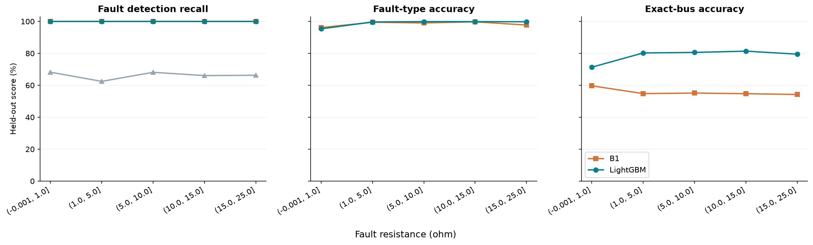
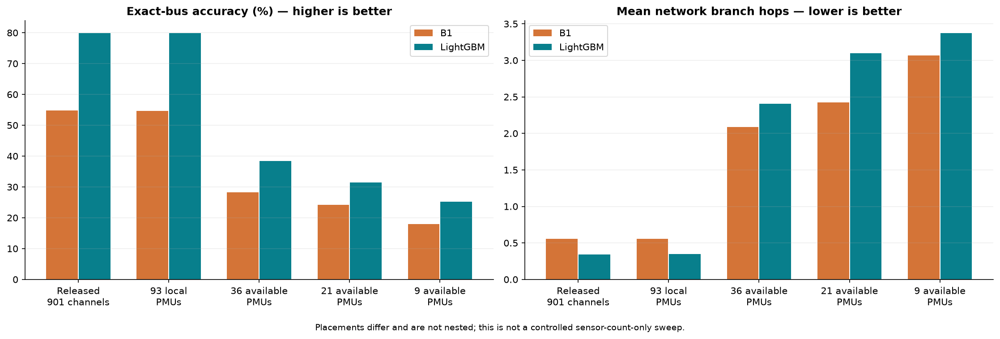

# EECE 490 — final executed experiment report

Run date: 2026-10-31. Every metric is calculated from saved predictions on the verified DER-Fault release. Scores are fractions (0–1), except branch hops, seconds and explicitly labeled percentage points. This is a research decision-support prototype, not certified electrical protection.

## Research answer

- detection: accuracy difference ML−B1 = 0.000 percentage points; metadata-load cluster bootstrap 95% interval [0.000, 0.000] points (difference not resolved by this interval). ML-only correct: 0; B1-only correct: 0.
- classification: accuracy difference ML−B1 = 1.028 percentage points; metadata-load cluster bootstrap 95% interval [0.722, 1.361] points (ML higher). ML-only correct: 46; B1-only correct: 9.
- localization: accuracy difference ML−B1 = 25.111 percentage points; metadata-load cluster bootstrap 95% interval [22.667, 27.417] points (ML higher). ML-only correct: 1192; B1-only correct: 288.

These are comparisons against the implemented B1, not all conventional protection techniques. Practical significance must be judged with the absolute error counts, sensor coverage, inference timing and model identifiability limits below. Detection cannot establish an ML advantage under realistic noise because normals have exactly zero disturbance. Type classification has a near-ceiling electrical baseline. Localization conclusions are limited by the approximate original circuit and B1's free-current transformer ambiguity. Shared pre-fault states prevent a claim of broad independent loading generalization.

**ML is not uniformly better.** B1 has higher full-channel top-5 location accuracy (99.5833% versus 99.4722%). With 36/21/9 available PMUs, ML has higher exact-bus accuracy but **larger mean branch-hop errors** than B1: its wrong guesses are farther away on average. Below 1 ohm, B1 type accuracy is 96.12% versus ML's 95.35% (one extra correct case among 129), so this small bin does not establish a reliable ML advantage. The most defensible conclusion is improved exact-bus ranking on this benchmark, with task- and metric-dependent tradeoffs.

## Held-out test comparison

| Task | Metric | B0 | B1 | LightGBM |
| --- | --- | --- | --- | --- |
| detection | accuracy | 0.661773 | 1.000000 | 1.000000 |
| detection | precision | 1.000000 | 1.000000 | 1.000000 |
| detection | recall | 0.660833 | 1.000000 | 1.000000 |
| detection | f1 | 0.795785 | 1.000000 | 1.000000 |
| detection | false_positive_rate | 0.000000 | 0.000000 | 0.000000 |
| classification | accuracy | N/A | 0.986111 | 0.996389 |
| classification | macro_f1 | N/A | 0.986102 | 0.996388 |
| localization | exact_bus_accuracy | N/A | 0.548056 | 0.799167 |
| localization | top3_accuracy | N/A | 0.959444 | 0.987222 |
| localization | top5_accuracy | N/A | 0.995833 | 0.994722 |
| localization | mean_branch_hops | N/A | 0.555000 | 0.339444 |

## Validation comparison

| Task | Metric | B0 | B1 | LightGBM |
| --- | --- | --- | --- | --- |
| detection | accuracy | 0.666851 | 1.000000 | 1.000000 |
| detection | precision | 1.000000 | 1.000000 | 1.000000 |
| detection | recall | 0.666111 | 1.000000 | 1.000000 |
| detection | f1 | 0.799600 | 1.000000 | 1.000000 |
| detection | false_positive_rate | 0.000000 | 0.000000 | 0.000000 |
| classification | accuracy | N/A | 0.990833 | 0.997500 |
| classification | macro_f1 | N/A | 0.990835 | 0.997500 |
| localization | exact_bus_accuracy | N/A | 0.547778 | 0.796944 |
| localization | top3_accuracy | N/A | 0.957222 | 0.985833 |
| localization | top5_accuracy | N/A | 0.994722 | 0.993333 |
| localization | mean_branch_hops | N/A | 0.563611 | 0.348056 |

Validation selected the models/rules, so these scores are selection-biased. Temperature scaling is also fitted on validation; its validation calibration metrics are fitted values. Final test scores were generated only after all full/sensor/unseen variants were selected and SHA-256-frozen in `results/final_freeze.json`. No final-test-based retuning was performed.

## Test composition and uncertainty

The final split contains **3,610 distinct cases: 3,600 faults (360 per type) and 10 normals**, across 12 held-out representative-load indices and all six DER configurations. All 164 faulted-bus classes occur. The train and validation splits have 10,839/3,608 cases, with 39/8 normals. See `config/split_manifest.csv` for exact IDs. 1,743 redundant normal cases are excluded globally with training/validation/test priority, and no identical full measurement vector crosses partitions. The resulting prevalence is artificial; accuracy and precision do not estimate utility field performance.

FPR uses only 10 distinct test normals. With zero observed false alarms, the exact two-sided 95% upper bound is about 30.85%, not proof of negligible FPR. Recall at a 1% FPR target is **N/A** for every method because independent normal-event support is insufficient. By-scenario FPR is N/A when no retained normal case exists. More varied independent normal events are the exact next requirement for a meaningful low-FPR study.

Type and bus metrics above are conditional on true fault cases; B1 uses its predicted fault type to localize. `metrics.csv` additionally reports detection-gated end-to-end type/location accuracy. Normal bus metadata is never a fault target. B0 supports detection only, so unsupported tasks are N/A. Full confusion matrices and per-class precision/recall are in `results/confusion/`; readable detection/type plots are in `reports/figures/`.

## DER scenario analysis

| value | task | metric | n | B1 | LightGBM |
| --- | --- | --- | --- | --- | --- |
| S1 | classification | macro_f1 | 600 | 0.989997 | 0.998333 |
| S1 | detection | recall | 601 | 1.0 | 1.0 |
| S1 | localization | exact_bus_accuracy | 600 | 0.586667 | 0.808333 |
| S2 | classification | macro_f1 | 600 | 0.986664 | 0.996667 |
| S2 | detection | recall | 601 | 1.0 | 1.0 |
| S2 | localization | exact_bus_accuracy | 600 | 0.568333 | 0.776667 |
| S3 | classification | macro_f1 | 600 | 0.984995 | 0.98997 |
| S3 | detection | recall | 602 | 1.0 | 1.0 |
| S3 | localization | exact_bus_accuracy | 600 | 0.528333 | 0.793333 |
| S4 | classification | macro_f1 | 600 | 0.983299 | 0.996667 |
| S4 | detection | recall | 603 | 1.0 | 1.0 |
| S4 | localization | exact_bus_accuracy | 600 | 0.541667 | 0.805 |
| S5 | classification | macro_f1 | 600 | 0.988318 | 0.998333 |
| S5 | detection | recall | 602 | 1.0 | 1.0 |
| S5 | localization | exact_bus_accuracy | 600 | 0.536667 | 0.798333 |
| S6 | classification | macro_f1 | 600 | 0.983248 | 0.998333 |
| S6 | detection | recall | 601 | 1.0 | 1.0 |
| S6 | localization | exact_bus_accuracy | 600 | 0.526667 | 0.813333 |

S1/S2/S3/S4/S5/S6 configure PV/EV/V2G percentages as 0/0/0, 30/0/0, 50/20/0, 70/30/0, 70/30/30 and 30/50/50. Profile multipliers also vary by hour. Different scenarios have different sampled fault buses and resistances. These results are scenario associations, not isolated causal effects of PV. S4/S5 share PV and EV levels while V2G differs.

## Fault resistance analysis

| value | task | metric | n | B1 | LightGBM |
| --- | --- | --- | --- | --- | --- |
| (-0.001, 1.0] | classification | macro_f1 | 129 | 0.959913 | 0.952147 |
| (-0.001, 1.0] | detection | recall | 129 | 1.0 | 1.0 |
| (-0.001, 1.0] | localization | exact_bus_accuracy | 129 | 0.596899 | 0.713178 |
| (1.0, 5.0] | classification | macro_f1 | 562 | 0.99537 | 0.996658 |
| (1.0, 5.0] | detection | recall | 562 | 1.0 | 1.0 |
| (1.0, 5.0] | localization | exact_bus_accuracy | 562 | 0.548043 | 0.802491 |
| (10.0, 15.0] | classification | macro_f1 | 725 | 0.996795 | 0.998637 |
| (10.0, 15.0] | detection | recall | 725 | 1.0 | 1.0 |
| (10.0, 15.0] | localization | exact_bus_accuracy | 725 | 0.547586 | 0.813793 |
| (15.0, 25.0] | classification | macro_f1 | 1453 | 0.976997 | 0.997929 |
| (15.0, 25.0] | detection | recall | 1453 | 1.0 | 1.0 |
| (15.0, 25.0] | localization | exact_bus_accuracy | 1453 | 0.542326 | 0.794907 |
| (5.0, 10.0] | classification | macro_f1 | 731 | 0.990384 | 0.99875 |
| (5.0, 10.0] | detection | recall | 731 | 1.0 | 1.0 |
| (5.0, 10.0] | localization | exact_bus_accuracy | 731 | 0.5513 | 0.805746 |

Bins were specified before final evaluation: 0–1, 1–5, 5–10, 10–15 and 15–25 ohm. Normal events are excluded from resistance bins because zero resistance in normal metadata is not a fault resistance. The EDA shows decreasing disturbance with resistance; model scores must be assessed separately, rather than assuming a weaker signal automatically means an ML advantage. Faults were not paired across resistance, so location/type distributions also influence each bin.

In the 15–25 ohm test bin, type accuracy is 97.73% for B1 and 99.79% for ML. The paired error analysis finds that ML-only type successes have median resistance 19.1245 ohm, while B1-only type successes have median 0.811 ohm. This supports an association between ML's type-classification benefit and weaker, high-resistance signatures in the available cases; it is not a controlled causal resistance experiment.



## Limited-sensor and unseen-configuration experiments

| experiment | task | metric | n | B1 | LightGBM |
| --- | --- | --- | --- | --- | --- |
| available_21 | classification | macro_f1 | 3600 | 0.985823 | 0.997779 |
| available_21 | detection | recall | 3610 | 1.0 | 1.0 |
| available_21 | localization | exact_bus_accuracy | 3600 | 0.241667 | 0.315 |
| available_21 | localization | mean_branch_hops | 3600 | 2.426667 | 3.095 |
| available_21 | localization | top3_accuracy | 3600 | 0.481944 | 0.533333 |
| available_36 | classification | macro_f1 | 3600 | 0.985823 | 0.998334 |
| available_36 | detection | recall | 3610 | 1.0 | 1.0 |
| available_36 | localization | exact_bus_accuracy | 3600 | 0.2825 | 0.383889 |
| available_36 | localization | mean_branch_hops | 3600 | 2.089722 | 2.403056 |
| available_36 | localization | top3_accuracy | 3600 | 0.556389 | 0.623333 |
| available_9 | classification | macro_f1 | 3600 | 0.983048 | 0.999444 |
| available_9 | detection | recall | 3610 | 1.0 | 1.0 |
| available_9 | localization | exact_bus_accuracy | 3600 | 0.179167 | 0.252222 |
| available_9 | localization | mean_branch_hops | 3600 | 3.069167 | 3.374722 |
| available_9 | localization | top3_accuracy | 3600 | 0.38 | 0.475278 |
| available_93 | classification | macro_f1 | 3600 | 0.986102 | 0.996387 |
| available_93 | detection | recall | 3610 | 1.0 | 1.0 |
| available_93 | localization | exact_bus_accuracy | 3600 | 0.546944 | 0.798889 |
| available_93 | localization | mean_branch_hops | 3600 | 0.558889 | 0.35 |
| available_93 | localization | top3_accuracy | 3600 | 0.959444 | 0.988889 |
| full | classification | macro_f1 | 3600 | 0.986102 | 0.996388 |
| full | detection | recall | 3610 | 1.0 | 1.0 |
| full | localization | exact_bus_accuracy | 3600 | 0.548056 | 0.799167 |
| full | localization | mean_branch_hops | 3600 | 0.555 | 0.339444 |
| full | localization | top3_accuracy | 3600 | 0.959444 | 0.987222 |
| unseen_s6 | classification | macro_f1 | 600 | 0.983248 | 0.998333 |
| unseen_s6 | detection | recall | 601 | 1.0 | 1.0 |
| unseen_s6 | localization | exact_bus_accuracy | 600 | 0.526667 | 0.811667 |
| unseen_s6 | localization | mean_branch_hops | 600 | 0.578333 | 0.355 |
| unseen_s6 | localization | top3_accuracy | 600 | 0.97 | 0.995 |

`full` uses all released measurements: 93 voltage buses and 726 current channels, including 339 remote terminal channels outside the published PMU_93 buses. It must not be described as a physically local 93-PMU measurement system. `available_93` retains the same 93 voltage buses but only 387 local current channels. This provides the reference for sensor-count reductions. `available_36`, `available_21` and `available_9` use intersections of the published PMU_56/36/20 lists with released voltage buses; they are **not** reproductions of the published observability placements. In every `available_N` case only line-current terminals at retained PMU buses are available. Both B1 and ML are independently selected using the same remaining measurements, load split and two-candidate ML search budget. Feature selection is fitted separately on training data for every variant. Model budget is fixed; this is not an exhaustive optimization.

`unseen_s6` excludes S6 from both training and selection validation, then evaluates S6 at held-out test loads. Its baseline is also tuned without S6. This avoids mixing seen loading groups into the shift test. Compare it to the full model's S6 rows in the scenario table. S6 changes EV/V2G as well as PV; it is a DER configuration shift, not a pure PV extrapolation.

Sensor placements are not nested. Reduced configurations change instrument locations as well as counts; do not claim a controlled causal sensor-count effect.



## Best LightGBM models and settings

| task | tag | k | num_leaves | n_estimators | min_child_samples | best_iteration | validation_selection_score | training_seconds | temperature | threshold |
| --- | --- | --- | --- | --- | --- | --- | --- | --- | --- | --- |
| detection | full | 256 | 7 | 100 | 10 | 100 | 1.0 | 1.270237 | 1.0 | 0.5 |
| classification | full | 512 | 15 | 160 | 5 | 160 | 0.9975 | 42.354345 | 0.929585 | N/A |
| localization | full | 512 | 15 | 160 | 5 | 39 | 0.796944 | 82.289781 | 1.007593 | N/A |

All candidates use learning rate 0.08, maximum bin count 63, L2 penalty 1, seed 490, deterministic column-wise trees, four threads and early stopping patience 20. Training-only ANOVA screening selects k features separately for each task. Detection has balanced training class weights; other tasks use natural class frequencies. The two candidates trade 256/512 features, 7/15 leaves, 100/160 maximum rounds and 10/5 minimum child samples. Ties favor the first candidate. Saved bundles are `artifacts/full_detection.joblib`, `full_classification.joblib`, and `full_localization.joblib`; each includes the selector, trained model and temperature/threshold. `config/features.json` defines the shared deterministic preprocessing.

B1 validation-selected rule settings:

```json
{
  "B0": {
    "voltage_sag": 0.1,
    "absolute_current_A": 72.49923939829759,
    "rationale": "10% voltage sag OR twice training-normal 99th-percentile maximum current. Not a thermal/CT equipment setting: ratings absent."
  },
  "B1_detection": {
    "current_weight": 0,
    "threshold": 1e-06
  },
  "B1_classification": {
    "single": 0.35,
    "triple": 0.5,
    "ground": 0.15,
    "current_weight": 1,
    "ground_source": "voltage"
  },
  "validation_macro_f1": 0.9908352317011702,
  "selection": "Rules tuned on validation only; B0 nominal current scale uses training normals. No test predictions.",
  "B1_localization": {
    "current_weight": 0.1,
    "validation_exact_bus_accuracy": 0.5477777777777778,
    "candidates": 164,
    "method": "least-squares sparse current-injection transfer residual, predicted fault phase constraints; source circuit approximation"
  }
}
```

## Explainability and electrical interpretation

| task | feature | mean_abs_raw_margin |
| --- | --- | --- |
| detection | bus2004_V_delta_seq1 | 1.670618 |
| detection | Line.l_3107_3118_T2_Ph2_I_pre_mag | 0.0 |
| detection | Line.l_3076_3077_T2_Ph1_I_pre_mag | 0.0 |
| detection | Line.l_3118_3119_T1_Ph1_I_pre_mag | 0.0 |
| detection | Line.l_2044_2053_T2_Ph1_I_pre_mag | 0.0 |
| classification | bus2001.3_V_delta_re | 1.421336 |
| classification | bus3001.1_V_delta_im | 1.257014 |
| classification | Line.l_2047_2048_T2_Ph1_I_delta_im | 0.458154 |
| classification | bus2004.1_V_delta_im | 0.425382 |
| classification | bus1002.1_V_delta_im | 0.40565 |
| localization | Line.l_3001_3003_T2_I_delta_seq1 | 0.292468 |
| localization | Line.l_3039_3053_T2_I_delta_seq1 | 0.27216 |
| localization | Line.l_2001_2002_T1_I_delta_seq1 | 0.263025 |
| localization | Line.l_2033_2034_T1_I_delta_seq1 | 0.234943 |
| localization | Line.l_3003_3005_T2_I_delta_seq1 | 0.230215 |

Native LightGBM TreeSHAP contributions were actually calculated on 100 reproducibly sampled held-out cases per task. They explain raw tree margins before temperature scaling; multiclass summaries average the predicted class's contributions. Additivity checks and sampled IDs are in `results/explainability_audit.json`. The contribution plots are in `reports/figures/*_treeshap.png`; complete rankings are in `results/*_treeshap.csv`.

`V_delta_re/im` express complex voltage displacement; sag and phase rotation both contribute. `I_delta_re/im` express incremental current on a particular line terminal and physical phase. Magnitude ratios describe relative disturbances, while absolute post-fault voltage/current helps identify where a fault lies. Incremental zero sequence indicates ground return; negative sequence indicates imbalance. Features with `PhN` retain source column names, so interpret their physical phase through `config/topology.json` NodeOrder, not the conductor ordinal. Attribution is statistical evidence conditional on correlated sensors, not a causal proof or a relay setting.

## Major failures and paired cases

| task | category | n | median_resistance_ohm |
| --- | --- | --- | --- |
| classification | B1_only_correct | 9 | 0.811 |
| classification | ML_only_correct | 46 | 19.1245 |
| classification | both_wrong | 4 | 4.682 |
| classification | both_correct | 3541 | 12.506 |
| localization | B1_only_correct | 288 | 11.952 |
| localization | ML_only_correct | 1192 | 12.499 |
| localization | both_wrong | 435 | 13.11 |
| localization | both_correct | 1685 | 12.525 |

Examples for every paired category are in `results/classification_*_examples.csv` and `results/localization_*_examples.csv`; complete errors are in `results/error_cases.csv`. Study B1-only successes as well as ML-only successes. B1's source-model current-injection subspaces can confuse transformer primary/secondary buses because fitted current is unconstrained by a fault-resistance law. This is a material localization limitation, even when coverage includes all labeled buses. The next stronger conventional comparator should use the exact study circuit and resistance-constrained candidate solves. The ML bus classifier is closed-set: a bus absent from training cannot be predicted reliably.

## Calibration and inference time

| experiment | partition | task | log_loss | ECE_10_bins | temperature |
| --- | --- | --- | --- | --- | --- |
| full | test | classification | 0.010645 | 0.001277 | 0.929585 |
| full | test | localization | 0.54524 | 0.081427 | 1.007593 |

Type/location temperature scaling is fitted on validation only. Confidence is calibrated at most for this artificial simulation distribution; it is not a real-world fault probability. Detection has too few normal events for a reliable calibration claim and is displayed as an uncalibrated score.

Location calibration remains imperfect: its held-out mean maximum class score is 0.8745 while exact-bus accuracy is 0.7992, and ten-bin ECE is 0.0814. Thus the location model is overconfident on average despite validation temperature scaling. The dashboard exposes a score, not a guaranteed probability of correctness; no further calibration was fitted using final-test outcomes.

| experiment | partition | rows | baseline_batch_seconds | ml_batch_seconds | baseline_batch_ms_per_case | ml_batch_ms_per_case | timing_scope |
| --- | --- | --- | --- | --- | --- | --- | --- |
| full | test | 3610 | 0.315741 | 0.871571 | 0.087463 | 0.241433 | prediction from precomputed features/phasors; excludes disk/model loading and feature extraction |

These are batch prediction timings from precomputed electrical features/phasors; they exclude file loading and feature extraction. They do not measure protection clearing time or guarantee real-time deadlines. The deployment smoke test additionally records per-case end-to-end service latency when available.

The executed API contract/replay check passed. Five warm replay cases took a mean 41.12 ms including input validation, feature construction, all three LightGBM models, B0 and B1; model/cache loading and HTTP transport are excluded. See `results/deployment_verification.json`. Streamlit's actual app/replay harness also passed (`results/dashboard_verification.json`).

Docker configuration is supplied, but **Docker is not installed on the execution host** (`where.exe docker` found no executable). The image has not been built or run. Exact next action: install/start Docker Desktop with Linux containers, then run `docker compose up --build` from the project root and check `/health` and the dashboard. This deployment substep remains incomplete.

## Statistical and engineering limits

Primary paired uncertainty uses 2,000 bootstrap resamples of the 12 held-out metadata load groups. `results/paired_statistics.json` also provides a descriptive discordant-pair binomial p-value, which ignores dependence and must not be treated as independent-case evidence. Multiple task/scenario/resistance comparisons are exploratory; no multiplicity-adjusted discovery claim is made. A small near-ceiling type-accuracy improvement may be statistically visible without changing practical protection decisions.

The 1,033 distinct pre-fault fingerprints, repeated across different load indices, weaken any interpretation as unseen electrical operating conditions. The dataset has no measurement noise, benign switching events, CT saturation, communication loss or dynamic inverter controls, and spans only one feeder with fault resistance up to 25 ohm. Source topology supports branch hops; it does not validate impedance-distance errors or an exact study-model reconstruction. A 436-named-bus OpenDSS graph includes secondary/source buses beyond the nominal 240-bus feeder description.

## Reproduction and next research actions

Use the commands in the project README and the pinned executed environment in `requirements-lock.txt`. Do not overwrite the frozen final experiment to improve scores; use a new experiment directory and a new independent holdout for follow-up tuning. Collect independent noisy normal events, obtain the exact generation circuit/scripts, add resistance-constrained conventional localization, and validate on a second network before making deployment or broad ML-superiority claims.
